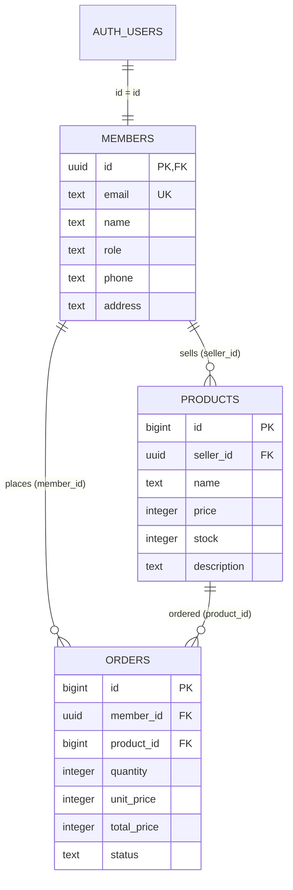

# supabase_DB — 쇼핑몰 회원 · 상품 · 주문 DB

> PostgreSQL(Supabase)에 회원·상품·주문 3개 테이블을 설계하고, uv 환경의 Python에서 Supabase SDK로 CRUD와 사용자별 접근 제어(RLS)를 구현한 과제입니다.


## 구현 범위

| 요구사항 | 구현 위치 |
| --- | --- |
| uv 프로젝트 생성 및 환경 구성 | `pyproject.toml`, `uv.lock`, `.python-version` |
| 회원·주문·상품 스키마 설계 (PK, FK, 제약조건) | [`sql/01_schema.sql`](sql/01_schema.sql) |
| Supabase 프로젝트 연동 | [`services.py`](services.py) `get_client()` |
| 3개 테이블 CRUD | [`services.py`](services.py), [`crud_demo.ipynb`](crud_demo.ipynb) |
| (심화) 트랜잭션 COMMIT / ROLLBACK | [`sql/02_transaction.sql`](sql/02_transaction.sql) |
| (심화) RLS 정책 · 예외 처리 | `sql/01_schema.sql` 5번, `crud_demo.ipynb` 4번 |

## 테이블 관계 (ERD)



## 테이블 상세

### 회원 `members`

| 컬럼 | 타입 | 키 | 제약조건 | 설명 |
| --- | --- | --- | --- | --- |
| `id` | uuid | **PK, FK** → `auth.users(id)` | NOT NULL, ON DELETE CASCADE | Supabase Auth 계정과 1:1 |
| `email` | text | UK | NOT NULL, UNIQUE | 로그인 이메일 |
| `name` | text | | NOT NULL | 이름 |
| `role` | text | | NOT NULL, DEFAULT `'BUYER'`, CHECK (`BUYER`, `SELLER`) | 회원 유형 |
| `phone` | text | | | 연락처 |
| `address` | text | | | 배송지 |
| `created_at` / `updated_at` | timestamptz | | NOT NULL, DEFAULT now() | `updated_at`은 트리거로 자동 갱신 |

### 상품 `products`

| 컬럼 | 타입 | 키 | 제약조건 | 설명 |
| --- | --- | --- | --- | --- |
| `id` | bigint | **PK** | IDENTITY | 상품 번호 |
| `seller_id` | uuid | **FK** → `members(id)` | NOT NULL, ON DELETE CASCADE | 판매자 |
| `name` | text | | NOT NULL | 상품명 |
| `price` | integer | | NOT NULL, CHECK (≥ 0) | 판매가 |
| `stock` | integer | | NOT NULL, DEFAULT 0, CHECK (≥ 0) | 재고 |
| `description` | text | | CHECK (500자 이하, ALTER로 추가) | 설명 |
| `created_at` / `updated_at` | timestamptz | | NOT NULL, DEFAULT now() | |

### 주문 `orders`

| 컬럼 | 타입 | 키 | 제약조건 | 설명 |
| --- | --- | --- | --- | --- |
| `id` | bigint | **PK** | IDENTITY | 주문 번호 |
| `member_id` | uuid | **FK** → `members(id)` | NOT NULL, ON DELETE RESTRICT | 주문자 |
| `product_id` | bigint | **FK** → `products(id)` | NOT NULL, ON DELETE RESTRICT | 주문 상품 |
| `quantity` | integer | | NOT NULL, CHECK (> 0) | 수량 |
| `unit_price` | integer | | NOT NULL, CHECK (≥ 0) | 주문 시점 가격 |
| `total_price` | integer | | GENERATED (`quantity * unit_price`) | 주문 금액 (자동 계산) |
| `status` | text | | NOT NULL, DEFAULT `'PENDING'`, CHECK (`PENDING`, `PAID`, `SHIPPED`, `DELIVERED`, `CANCELED`) | 주문 상태 |
| `ordered_at` / `updated_at` | timestamptz | | NOT NULL, DEFAULT now() | |

**설계 메모**
- 명명 규칙: 테이블은 복수형 snake_case, PK는 `id`, FK는 `<대상>_id`, 제약조건은 `<테이블>_<컬럼>_<pk|fk|ck|uq>`.
- 주문 이력을 지키기 위해 주문이 있는 회원·상품은 삭제할 수 없도록 `RESTRICT`를 사용했습니다.
- 주문 금액은 저장 시 계산 오류가 없도록 생성 컬럼으로 두었습니다.

### RLS 정책

| 테이블 | 조회 | 등록 | 수정 · 삭제 |
| --- | --- | --- | --- |
| `members` | 본인 | 본인 id로만 | 본인 |
| `products` | 모두 (비로그인 포함) | `role = 'SELLER'`인 본인 명의로만 | 본인 상품 |
| `orders` | 본인 주문 | 본인 명의로만 | 본인 주문 |

## 실행 방법

### 1. 환경 구성

```bash
git clone https://github.com/bsis09872-ux/supabase_DB.git
cd supabase_DB
uv sync
```

### 2. Supabase 준비

1. [Supabase](https://supabase.com)에서 새 프로젝트를 만듭니다.
2. **SQL Editor**에 [`sql/01_schema.sql`](sql/01_schema.sql) 전체를 붙여 넣고 실행합니다. 마지막 결과로 PK/FK 목록이 나옵니다.
3. **Authentication → Sign In / Providers → Email**에서 *Confirm email*을 끕니다. (데모 계정을 바로 로그인시키기 위함)
4. `.env.example`을 `.env`로 복사하고 **Project Settings → API Keys**의 URL과 Publishable key, 데모 계정 정보를 입력합니다. `.env`는 커밋하지 않습니다.

### 3. CRUD 실행

VS Code에서 [`crud_demo.ipynb`](crud_demo.ipynb)를 열고 커널로 `.venv`를 선택한 뒤 위에서부터 실행합니다.

### 4. 트랜잭션 확인

노트북 실행 후 SQL Editor에서 [`sql/02_transaction.sql`](sql/02_transaction.sql)의 블록을 순서대로 실행합니다.

## 실행 결과 캡처

### 테이블 PK / FK


### 회원 CRUD


### 상품 CRUD


### 주문 CRUD


### RLS · 예외 처리


### 트랜잭션 COMMIT / ROLLBACK


## 프로젝트 구성

```text
supabase_DB/
├── sql/
│   ├── 01_schema.sql       # 테이블·제약조건·트리거·RLS 생성, PK/FK 확인 쿼리
│   └── 02_transaction.sql  # COMMIT / 실패 시 ROLLBACK 시나리오
├── services.py             # MemberService, ProductService, OrderService
├── crud_demo.ipynb         # CRUD·RLS 시연 노트북 (캡처 원본)
├── docs/images/            # README 캡처 이미지
├── .env.example            # 환경 변수 예시
├── pyproject.toml / uv.lock / .python-version
└── README.md
```

팀 프로젝트 [AX_TeamDB](https://github.com/Cocode96/AX_TeamDB)의 회원·상품·주문 서비스 구조를 바탕으로 개인 과제에 맞게 스키마와 코드를 새로 정리했습니다.
